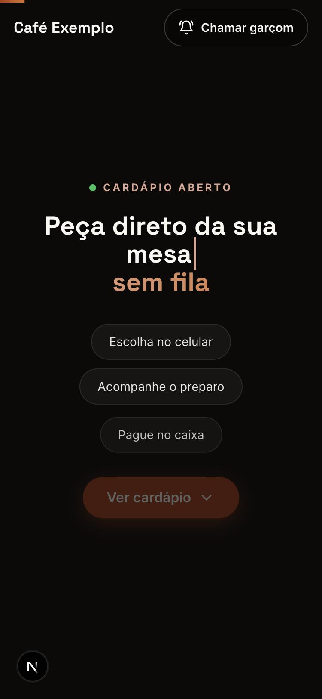
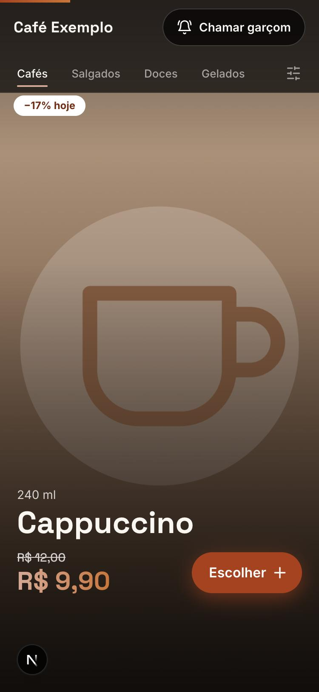
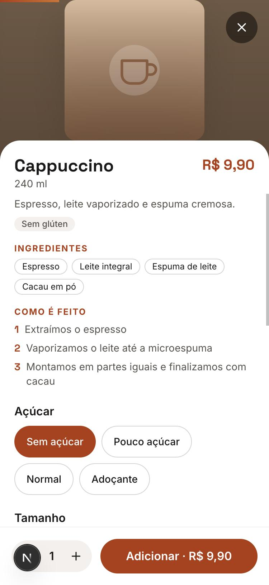
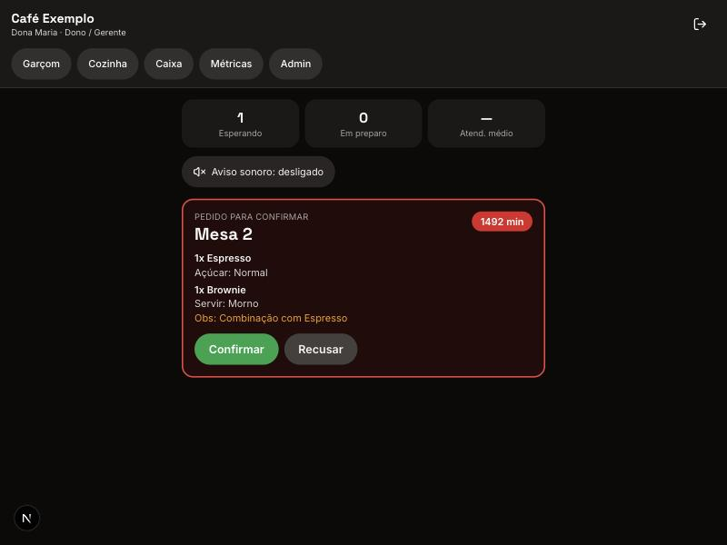
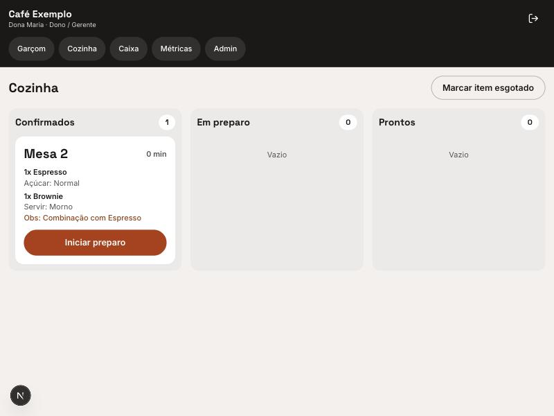
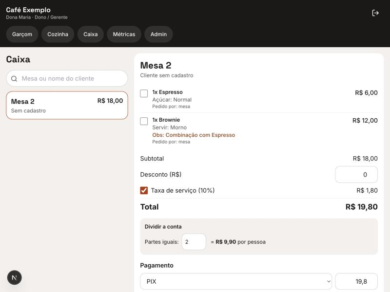
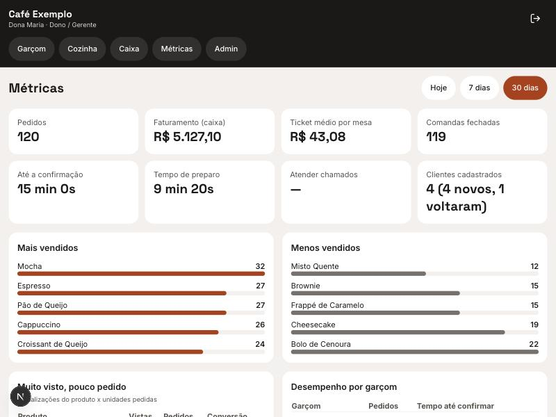
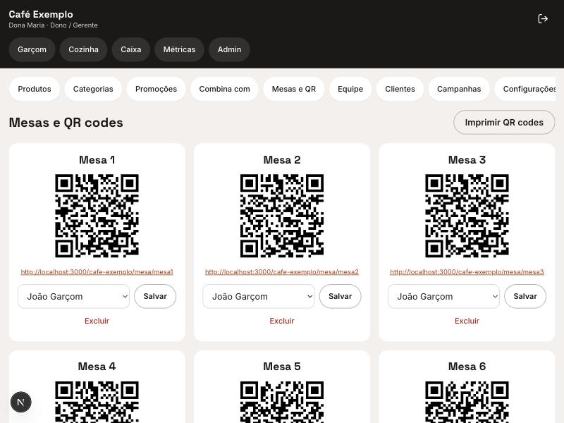
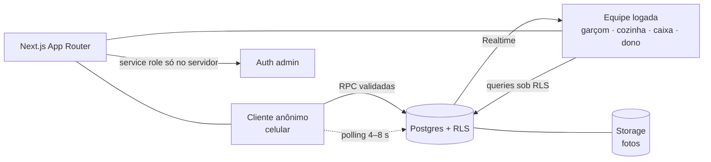

# Cardápio Digital com Comanda por Mesa

Web app mobile-first para cafeterias e restaurantes. O cliente abre o cardápio pelo celular a partir do link da mesa (tag NFC ou QR code), monta a comanda e envia o pedido. O garçom confirma, a cozinha prepara, o garçom entrega e o caixa fecha a conta. O dono gerencia cardápio, promoções e acompanha métricas.

> **Status:** MVP funcional rodando localmente (fases 1 a 5 concluídas). Falta o acabamento da fase 6: PWA, testes automatizados e deploy. Veja o [roadmap](#roadmap).
> **Publicar:** veja [`docs/deploy.md`](docs/deploy.md).
> **Uso real:** ainda sem estabelecimentos em produção. Os números reais, quando existirem, ficam em [`docs/numeros.md`](docs/numeros.md).

## O problema
Em café e restaurante, o cliente espera o garçom para pedir, para pedir a conta e para saber se o pedido saiu. O salão perde tempo e o pedido se perde. A ideia é tirar o cliente da fila de espera **para pedir**, sem tirar o garçom do controle: todo pedido passa pela confirmação dele, o que evita pedido falso de quem fotografou o QR fora do café.

## Telas

| Cliente (celular, sem login) | | |
|---|---|---|
|  |  |  |
| Abertura com texto digitado e animações ligadas ao scroll | Uma foto por tela, com promoção e preço | Detalhe: ingredientes, modo de preparo, opções e combinação |

| Equipe e dono (desktop/tablet) | |
|---|---|
|  |  |
| Garçom: pedidos por urgência, em tema escuro. O alerta vermelho aparece quando passa do limite de espera (o pedido do print é de teste, de um dia atrás) | Cozinha: colunas Confirmados → Em preparo → Prontos |
|  |  |
| Caixa: desconto, taxa de serviço, divisão e pagamento | Métricas do dono (**dados fictícios do seed**) |
|  | |
| Admin: mesas com QR code para imprimir | |

## Funcionalidades
- **Cliente:** cardápio em feed, filtro de alergênicos, preço promocional com janela de horário, selo "Mais pedido hoje", opções por produto (ex.: açúcar), combinação com qualquer outro item, chamar garçom, pedir a conta, perfil com consentimento LGPD e cartão fidelidade.
- **Garçom:** fila ordenada por urgência, destaque de espera, confirmar/recusar com motivo, "estou indo", entregar; atualização em tempo real com aviso sonoro opcional.
- **Cozinha:** quadro de três colunas e marcação de item esgotado.
- **Caixa:** busca por mesa ou nome, desconto automático para cliente cadastrado, taxa de serviço removível, divisão da conta, múltiplas formas de pagamento.
- **Admin do dono:** produtos (fotos, variações, adicionais, ingredientes, opções), categorias com horário, promoções, "combina com", mesas com QR, equipe, clientes (CSV), campanhas (só cadastro, sem envio) e configurações.
- **Métricas:** pedidos, faturamento, ticket médio, mais e menos vendidos, "muito visto, pouco pedido", pedidos por horário, tempos de atendimento e preparo, desempenho por garçom.

## Arquitetura



- **Next.js (App Router) + TypeScript + Tailwind**, sem biblioteca de UI.
- **Supabase:** Postgres, Auth (só equipe), Row Level Security, Realtime e Storage.
- **Multi-estabelecimento:** um banco, `estabelecimento_id` em toda tabela, isolamento por RLS.
- **Regra de negócio no banco:** pedido, chamado, perfil e fechamento de conta são funções SQL que validam tudo e recalculam preços no servidor.

As escolhas e os motivos estão no [log de decisões](docs/decisoes.md).

## Segurança (resumo)
- Cliente anônimo **não escreve** nas tabelas; só chama RPCs validadas. O preço enviado pelo navegador é ignorado.
- Limite de pedidos e chamados por sessão, e todo pedido exige confirmação do garçom.
- RLS em todas as tabelas; papéis checados também no `middleware` do Next.
- Nenhuma chave secreta no front-end (`SUPABASE_SERVICE_ROLE_KEY` só no servidor). Veja `.env.example`.
- Risco conhecido e documentado: perfil identificado por WhatsApp sem verificação ([D11](docs/decisoes.md)).

## Rodar localmente
Requisitos: Node 18.18+ (22 recomendado) e Docker em execução.

```bash
npm install
npx supabase start           # aplica migrations e seed (1ª vez baixa imagens; pode demorar)
cp .env.example .env.local   # preencha com as chaves de `npx supabase status`
npm run dev                  # http://localhost:3000
```

Recriar o banco do zero: `npx supabase db reset`.

- Cliente: http://localhost:3000 (escolhe a mesa) ou direto em http://localhost:3000/cafe-exemplo/mesa/mesa1 (mesa1 … mesa10)
- Equipe (dono, gerente, garçom, cozinha, caixa): http://localhost:3000/gestao · Studio: http://127.0.0.1:54323

### Usuários de teste (senha de todos: `Teste@1234`)
| Papel | E-mail | Acessa |
|---|---|---|
| Dono | dono@cafeexemplo.com | tudo |
| Garçom | garcom@cafeexemplo.com | /painel/garcom |
| Cozinha | cozinha@cafeexemplo.com | /painel/cozinha |
| Caixa | caixa@cafeexemplo.com | /painel/caixa |

## Estrutura
```
supabase/migrations/   schema, RLS e funções RPC (SQL versionado)
supabase/seed.sql      Café Exemplo: mesas, produtos, equipe e histórico para métricas
src/app/               rotas: cliente ([slug]/mesa/[codigo]), login e painel/*
src/components/        cliente/, painel/, admin/, ui/
src/lib/               supabase, auth, realtime, formatação
docs/decisoes.md       log de decisões   ·   docs/numeros.md   números reais
docs/prints/           capturas de tela  ·   scripts/          consulta de métricas reais
```

## Roadmap
- [x] Fundação: schema, RLS, seed, autenticação e rotas por papel
- [x] Cliente: cardápio, comanda, chamados, perfil
- [x] Operação em tempo real: garçom, cozinha, caixa
- [x] Admin e métricas
- [ ] PWA instalável (manifest, ícones, offline básico)
- [ ] Testes: lógica de preço/promoção (unitários) e fluxo pedido → fechamento (E2E)
- [ ] Deploy na Vercel + projeto Supabase em produção
- [ ] Troca de senha no primeiro acesso da equipe; verificação do WhatsApp
- [ ] Botão "ver em lista" para cardápios longos
- Fora do escopo por enquanto: envio de WhatsApp (as campanhas ficam salvas para uma automação externa), gravação de tags NFC, pagamento online, modelo 3D, integração com PDV.
